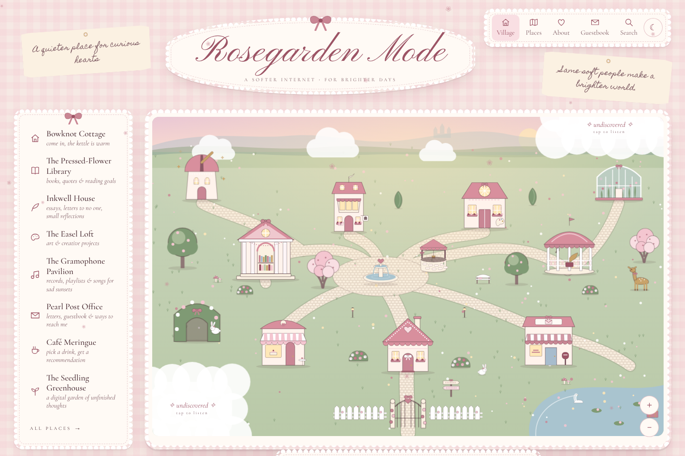

# Ribbonmere 🎀

*a little village at the quiet end of the internet*

Ribbonmere is a personal website, an explorable storybook village and a private internet headquarters, all in one. It belongs to you: you can redecorate, rename, rearrange and extend almost everything from a built-in design studio, without touching code.



It has three modes:

| Mode | Who sees it | What it is |
|---|---|---|
| **Rosegarden Mode** | everyone | The public village. Illustrated buildings are the navigation: a library, a journal house, an art loft, a music pavilion, a post office with a guestbook, a café, a digital-garden greenhouse, an observatory, a webring well, and a secret garden for the curious. |
| **Dollhouse Mode** | only you | Your private sanctuary. It has the Letterbox (save-for-later inbox with a cooldown), Reading Room, Diary, Cabinet of Curiosities (bookmarks), Favorites (an RSS reader for creators you follow), and a dashboard of widgets you can arrange. |
| **Stargirl Mode** | only you | Intentional exploration. Rabbit Holes are timed or untimed expeditions where you pocket discoveries, alongside Curated Picks, Saved Discoveries and Collections. |

Behind them is **the Atelier**, your design studio. It has a Canva-style map and room editor, the Theme Closet, room templates, a media library, village settings and backups.

### Ribbonmere 2.0

Everything in 2.0 is optional and reversible from one place, **Atelier → Features**. Each feature can be switched on, hidden, rested or reset, and a reset only clears that feature's own things. There are no streaks, no decaying pets and no guilt notifications.

| Area | What's new |
|---|---|
| **A living world** | Pet companions (bunny, fawn, kitten, swan) with accessories. *My Bedroom*. Weather. Day & night light. Little tap interactions. Seven landscapes to wander on the *Paths* page. |
| **Your personal internet** | The Morning Paper (daily editions from your feeds). The Video Parlour. The Reading Journal. The Commonplace Book. Time Capsules. The Rabbit-hole Map. |
| **Creative spaces** | Picture House. Record Shop. Bookshop. Memory Museum. Scrapbook Studio with picture downloads. Writing Desk with wax seals and optional share-by-link. |
| **Gentle play** | Achievements, pretend pearls, a Charm Shop where everything is also free elsewhere, and five untimed games in a Games Parlour. |
| **Appearance** | Coquette, Quiet (calm and readable; Alt + Q), Pixie (pixel art) and Midnight. |

What's built, how it was tested and what's left is recorded in **[docs/RIBBONMERE_2_STATUS.md](docs/RIBBONMERE_2_STATUS.md)**.

👉 **New here? Read the [Owner's Guide](docs/OWNERS_GUIDE.md).** It's written for people who don't code.
👉 **Putting it online for free:** follow the [Cloud Setup Guide](docs/CLOUD_SETUP_GUIDE.md) (Cloudflare Pages + Firebase, no credit card).

## Two ways to run Ribbonmere

The same website, with all the same features and the same backup format, can run on either backend:

| | **Cloud version** (recommended) | **Home-server version** |
|---|---|---|
| Hosting | Cloudflare Pages (free) | Any computer or VPS running Node |
| Your data | Firebase Firestore (free Spark plan), synced across devices, works offline | One SQLite file in `data/` |
| Sign-in | Firebase Authentication (email + password) | One owner password |
| Feeds, previews, images | Cloudflare Pages Functions; images in Workers KV (private by default) | The Node server |
| Privacy enforced by | Firestore security rules (tested) + owner-only functions | The Node server |
| Set up with | [Cloud Setup Guide](docs/CLOUD_SETUP_GUIDE.md) | Quick start below |

Cloudflare builds pick the cloud version automatically (`CF_PAGES` is set during their builds). `npm run dev` on your computer uses the home server, and `npm run dev:cloud` runs the full cloud version locally on the official emulators. The [migration audit](docs/MIGRATION_AUDIT.md) explains how each feature maps across and what the free tiers allow.

---

## Quick start

You need [Node.js](https://nodejs.org) **22.13 or newer**.

```bash
npm install
npm run dev
```

Open http://localhost:5173. The terminal prints a **first-run setup code**. Click *Sign in*, enter the code, and choose your password. (Or start with `OWNER_PASSWORD=your-password npm run dev` to skip the code.)

To run it the way it runs on a real server:

```bash
npm run build
npm start            # http://localhost:8787
```

Everything you create is stored in the `data/` folder: a single SQLite database (`world.db`) plus `uploads/`. Back that folder up, or use **Atelier → Backups**.

## Why this stack

- **React + TypeScript + Vite** for the client. The village, editor and dashboard are highly interactive, and TypeScript keeps the world/theme data formats consistent between client and server (`shared/types.ts`).
- **Node + Express** for a small server. It does the things a browser can't do safely: access control for private content, fetching RSS feeds and link previews (browsers block cross-site requests), handling uploads, and backups.
- **SQLite via Node's built-in `node:sqlite`.** That's one file, with nothing to install or host separately and no native compilation. It's easy to back up and easy to move.
- **No cloud services required.** No accounts with third parties, no API keys, and no lock-in. Fonts ship with the site.

## How it's built

```
shared/            data formats used by both sides
  types.ts         Item, Room, SceneObject, WorldConfig, ThemeTokens…
  defaultWorld.ts  the starting village (only a seed; your edits live in the database)
  themes.ts        theme presets (all colours/fonts are tokens)
server/
  app.ts           API: auth, items, config draft/publish/versions, feeds, uploads, search, backups
  feeds.ts         RSS/Atom parsing, feed discovery, YouTube channel feeds, link previews
  safeFetch.ts     outbound fetching with private-network (SSRF) protection, size & time limits
  auth.ts          single-owner password (scrypt), hashed session tokens, rate limiting
  tests/           API tests (node:test)
src/
  art/             original SVG illustrations (buildings, creatures, decor) — recolour from tokens
  world/           the map renderer (Scene) shared by the village, freeform rooms and the editor
  rooms/           room templates + the schema-driven content editor
  private/         Dollhouse & Stargirl modes: letterbox, cabinet, reader, dashboard, expeditions
  atelier/         the design studio: scene editor, theme closet, rooms, media, settings, backups
  lib/             API client, theme engine, store, small markdown renderer
```

**Everything is data.** A building on the map is a `SceneObject` with an artwork key (or your uploaded image), a position in a fixed 1600×1000 coordinate system, a layer, colours, an animation and the room it opens. A room is `{ id, name, template, visibility, … }`. Adding a room from a template, or a building that opens it, is a data change made in the Atelier, not a code change.

**Draft → publish.** The owner always edits a *draft* of the village and theme. Visitors only ever receive the *published* copy, filtered by the server. Every publish saves a checkpoint you can roll back to.

**Privacy is enforced on the server.** Visitors' requests never receive private items, private rooms (or anything inside them), owner-only map objects, unrevealed regions' contents, drafts, the dashboard, bookmarks, the letterbox, expeditions or feeds. That holds whether they use the interface, direct URLs or the API. New personal notes, journal pages, bookmarks and letterbox items are private by default. *See it as a visitor* (the ☾ menu) shows exactly what the server sends to an anonymous visitor.

## Testing

```bash
npm test                              # home server: 12 API tests (auth, privacy, feeds, uploads, guestbook, backups)
npm run test:rules                    # cloud: Firestore security rules on the official emulator (outsiders, other accounts, guests, owner)
npm run build && npm run test:functions  # cloud: Pages Functions in Cloudflare's local runtime + real RS256 token checks
npm run screenshots                   # home server: end-to-end in Chromium (17 checks) + screenshots
npm run test:cloud                    # cloud: end-to-end in Chromium against Firebase emulators + wrangler (incl. 2.0 checks)
npm run build && npm run test:v2      # Ribbonmere 2.0: every feature's lifecycle (use → hide → rest → on → reset), privacy, appearance, phone layout
                                      #   (run some sections only: npm run test:v2 -- pets letters paths)
```

The cloud end-to-end run covers signing in, seeding the village, the setup checklist, and privacy (checked against Firestore directly, not only the pages). It also covers live sync between two devices, offline editing, private-by-default images, the RSS reader through the function, the letterbox and expeditions, autosave, draft and publish, theme sync, the moderated and rate-limited guestbook, search, backups, migrating a real SQLite database, every room template, bookmarks, widgets, new rooms starting private, checkpoints, OPML, replace-restore guarded by a safety backup, password change, the phone layout and reduced motion.

The end-to-end script starts a real server on a temporary data folder and exercises the main flows:
- **Visitors:** the intro, the map, rooms, the café, and being refused at the private wing.
- **Signing in** as the owner.
- **Privacy:** adding public and private books and confirming the private one is absent from both the page and the public API.
- **Your own tools:** letterbox capture, cooldown and review; bookmarks; expeditions; dashboard widgets persisting.
- **Editing:** dragging a building in the editor (draft vs. published, then publish), changing and persisting a theme, uploading an image, and creating and arranging a freeform room.
- **Comfort and access:** no sideways scroll on a phone, and reduced-motion respected.

**What could not be tested here:** fetching *live* RSS feeds and link previews from real websites, because this development sandbox has no general internet access. The feed reader is tested against local RSS and Atom fixtures (including feed discovery from an HTML page). Real-world feeds use the same code path, but check a few of your own subscriptions after deploying. The Android share-sheet integration and iPhone home-screen install also need a real device.

## Deploying

Ribbonmere is one Node process plus one data folder, so it runs anywhere that has **persistent disk**.

**Docker (any VPS, Fly.io, Railway, Render…):**

```bash
docker build -t ribbonmere .
docker run -d -p 8787:8787 -v ribbonmere-data:/data -e OWNER_PASSWORD='choose-a-long-one' ribbonmere
```

**Without Docker (e.g. a small VPS):**

```bash
npm ci && npm run build
NODE_ENV=production DATA_DIR=/var/lib/ribbonmere PORT=8787 npm start
```

Put it behind HTTPS (Caddy, nginx, or your host's built-in TLS). In production the session cookie is marked `Secure`, so **HTTPS is required for signing in**.

Notes:
- **Hosts:** make sure the data directory is on a persistent volume. Free tiers that wipe the disk on restart will lose your world. Render's free web services and similar are fine *only* with an attached disk.
- **Proxies:** if your host puts a proxy in front of the app (most do), set `app.set('trust proxy', …)` in `server/app.ts` to match so rate limiting sees real visitor IPs. It currently trusts only loopback.
- **Static hosting won't work:** Netlify, Vercel or GitHub Pages can't host this as-is. It needs the server for privacy, feeds and uploads.

| Environment variable | Default | Meaning |
|---|---|---|
| `PORT` | `8787` | Port to listen on |
| `DATA_DIR` | `./data` | Where `world.db` and `uploads/` live |
| `OWNER_PASSWORD` | — | Sets the owner password on first start (skips the setup code) |
| `NODE_ENV` | — | `production` enables secure cookies and the content-security policy |

## Status: what's done and what's next

**Working now:**
- **Public village (Rosegarden Mode).** Interactive map with hover signboards, keyboard access, zoom and pan on phones, drifting clouds, unrevealed regions under clouds, easter eggs with collectible stamps, seasonal effects, and an intro.
- **Room templates.** Welcome, Library (shelves, drag-to-rearrange, book pages, quotes, reading goal, hidden messages), Journal, Gallery, Music (YouTube/Spotify/SoundCloud embeds), Post Office (moderated guestbook with spam protection), Café, Digital Garden (stages, `[[links]]`, backlinks), Observatory, Secret room, Collection, and Freeform.
- **Dollhouse Mode.** The Letterbox (cooldown, keep/later/collection/archive/delete, tags, reminders, search, sort), the Cabinet (collections, tags, favourites, previews, Netscape bookmark import/export), Favorites (an RSS/Atom reader with discovery, YouTube channel and playlist feeds, categories, read/unread, saved, OPML import/export), Reading Room, Diary, and the widget dashboard.
- **Stargirl Mode.** Guided and wandering expeditions with an optional gentle timer, discoveries, field notes, history, moving finds to the letterbox or cabinet, and curated picks.
- **Atelier.** Map editor (drag, resize, snap, alignment guides, layers, duplicate, delete with restore, undo/redo, zoom, colours per building, replace artwork with uploads, easter eggs, regions, draft/publish/preview/checkpoints), freeform room editor, Theme Closet (6 presets plus Stargirl Night, custom themes, every colour, fonts, frames, buttons, textures, cursor, hover, animation level, seasonal effect, per-location colours, contrast warning, theme import/export), rooms from templates (create, duplicate with content, remove, visibility, place on map), media library, village settings (name, modes, intro, garden stages, regions), password change, and backups and checkpoints.
- **Everywhere:** universal search (private results only for the owner), a visitor preview, an installable PWA with a share target, a bookmarklet, reduced-motion support, comfort toggles, and keyboard focus styles.

**Ideas for later (not built yet):**
- Email or push notifications for letterbox reminders. Reminders currently show on the letterbox and dashboard only.
- Integrations with Readwise Reader or Raindrop. Both have APIs that need your personal tokens, so they would be added as optional server-side connectors.
- Multi-select and group-move in the editor, rotation by dragging, and more artwork (interiors, more creatures, seasonal decorations).
- Built-in scheduling to switch seasonal themes automatically. Today you switch them yourself in the Theme Closet.
- A "now reading" public widget and RSS output of your own journal.
