# The Owner's Guide to Ribbonmere ♡

This guide is for you, the person who lives here. It doesn't assume you know how to code. If you can use Canva, you can run this world.

**Contents**
1. [Open and run the website](#1-open-and-run-the-website)
2. [Enter your private studio (the Atelier)](#2-enter-your-private-studio)
3. [Change colours and fonts](#3-change-colours-and-fonts)
4. [Upload your own illustrations](#4-upload-your-own-illustrations)
5. [Move buildings and decorate the map](#5-move-buildings-and-decorate-the-map)
6. [Create new rooms](#6-create-new-rooms)
7. [Add books and journal pages](#7-add-books-and-journal-pages)
8. [Follow creators with RSS](#8-follow-creators-with-rss)
9. [Save links and organise collections](#9-save-links-and-organise-collections)
10. [Back up your world](#10-back-up-your-world)
11. [Publish changes](#11-publish-changes)
12. [Use it from your phone](#12-use-it-from-your-phone)
13. [Private vs. public: how it works](#13-private-vs-public)

---

## 1. Open and run the website

**On your own computer (for trying things out):**
1. Install **Node.js** (version 22 or newer) from [nodejs.org](https://nodejs.org). It's a normal installer.
2. Open a terminal in the Ribbonmere folder. On a Mac, that's Terminal; on Windows, PowerShell.
3. Type `npm install` and press Enter. You only need to do this once.
4. Type `npm run dev` and press Enter.
5. Open **http://localhost:5173** in your browser.

The first time it starts, the terminal shows a line like:

```
♡ Ribbonmere first-run setup code: 4f9a1c2e
```

Click **Sign in** (in the ☾ menu at the top), type that code, and choose your password. From then on, you sign in with just your password.

**On the internet (so others can visit):** see *Deploying* in the [README](../README.md). The short version: use a host that gives you a server with a **persistent disk**, and run the Docker image.

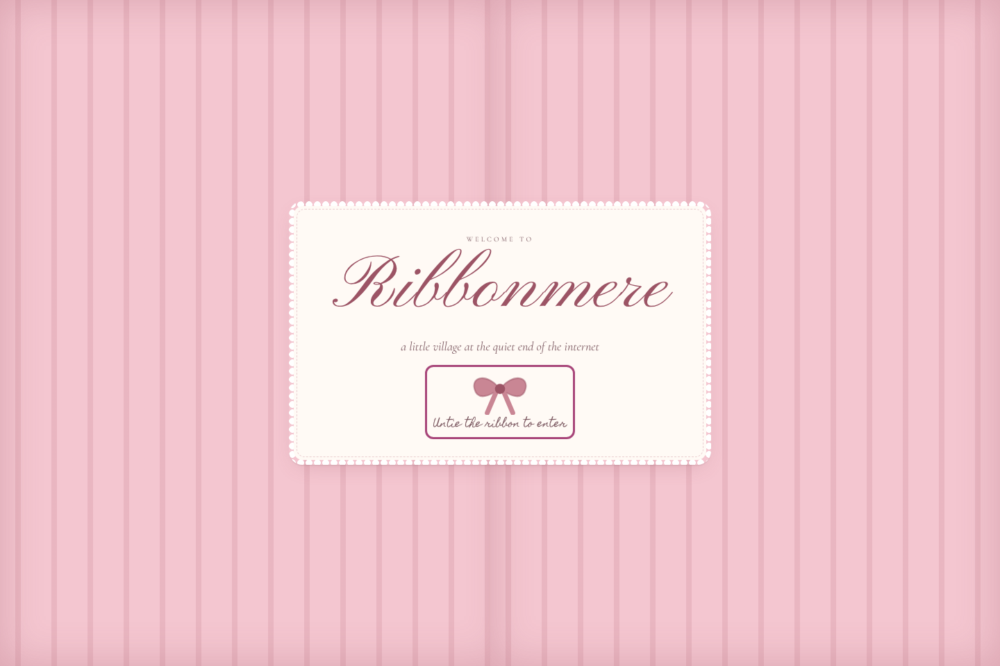

## 2. Enter your private studio

Once you're signed in, the menu at the top gains three new doors:

- **Dollhouse**: your private sanctuary (letterbox, reading room, diary, bookmarks, favourite creators).
- **Stargirl**: exploration mode.
- **Atelier**: the design studio where you change how everything looks.

Only you can see these. On the village map you'll also see a ribbon-curtained door (*The Private Wing*). Visitors don't get that door at all.

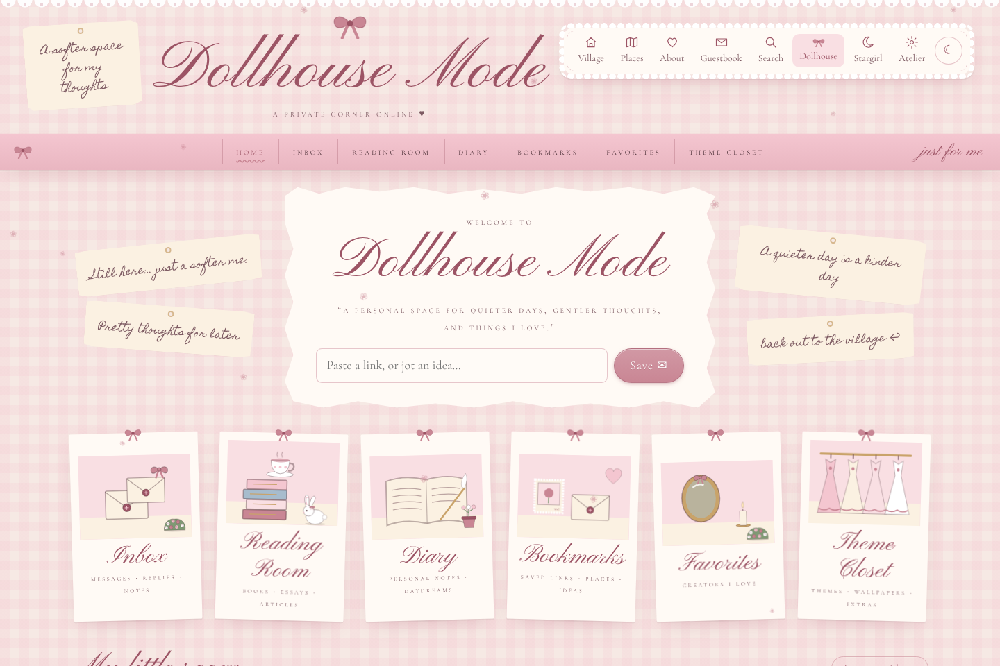

## 3. Change colours and fonts

Go to **Atelier → Theme closet**.

1. **Try a preset.** Click *Ribbonmere Coquette*, *Spring Rose Garden*, *Autumn Cottage*, *Winter Sugarplum*, *Vintage Valentine*, *Stargirl Night* or *Midnight Fairytale*. The whole site changes instantly as a preview.
2. **Change any colour.** Click a colour square (for example *Roofs* or *Baby pink*) and pick a new shade.
3. **Fonts.** Choose fonts for headings, body text, script titles and little pixel labels, and set the text size.
4. **Frames, buttons, texture, cursor, hover, animation and seasonal effect.** Click the little chips to choose.
5. **Location colours.** Give one room its own shade, for example a darker library.
6. Press **Save theme**. Your changes are stored as a draft. Press **Publish** when you want visitors to see them.

Want to keep this look as your own? Press **Save as my own theme**. It appears in your list of themes and can be exported to a file and imported again later.

If the text becomes hard to read, a little warning appears under the colours.

> **Changing one cottage's colour:** go to the map editor (step 5), click the cottage, and use the colour squares in *Colours* (roof, wall, trim, accent, window).

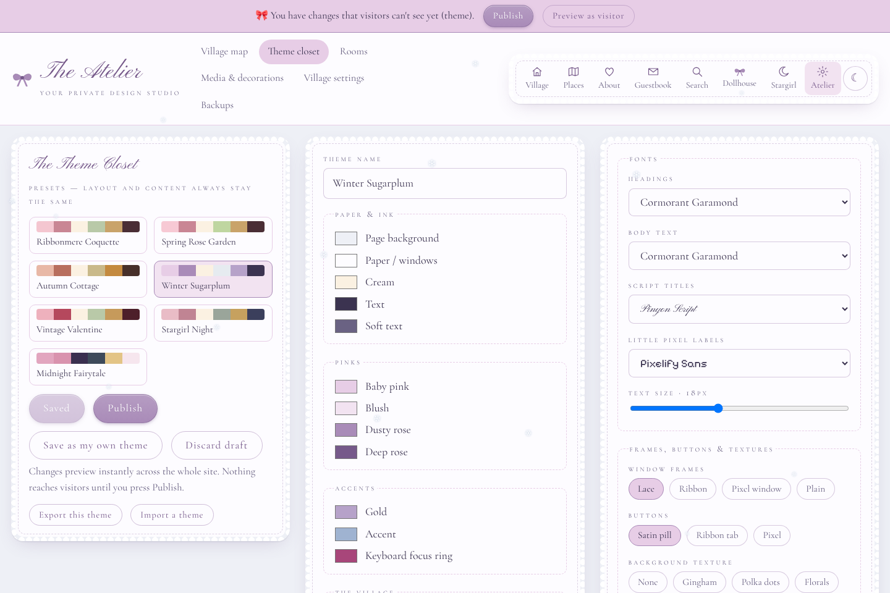

## 4. Upload your own illustrations

Go to **Atelier → Media & decorations**.

1. Choose a category (Illustrations, Flowers & Plants, Furniture, Bows & Ribbons…).
2. Press **Choose images**. PNG, JPEG, WebP, GIF and SVG all work. **Transparent PNGs** from Procreate or Canva look best as decorations.
3. Your images appear in the grid. Rename them or move them to another category any time.

Uploaded images now show up at the top of the editor's object library. They can be dragged onto the map or into freeform rooms. To **replace a building's artwork** with your own drawing, select the building in the map editor and use *Replace artwork with my own image*. You can also pick an image for book covers, artworks, record sleeves and more when you edit those.

## 5. Move buildings and decorate the map

Go to **Atelier → Village map**.

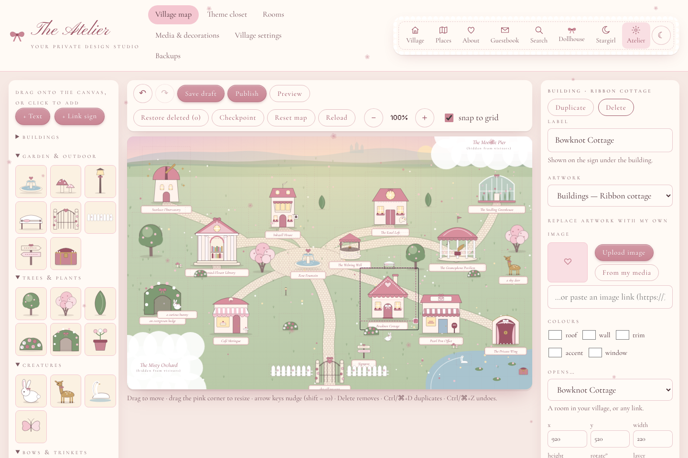

- **Move:** drag anything.
- **Resize:** drag the pink square in the bottom-right corner of the selected object. Tick or untick *keep proportions*.
- **Nudge:** arrow keys (hold Shift for bigger steps).
- **Add:** drag a tree, bunny, bow, lamp post (anything from the left-hand library) onto the map, or just click it.
- **Change:** use the right-hand panel to rename, change the artwork, choose which room it opens (or a web link), set colours, rotation, opacity, layer (*Bring to front* / *Send to back*), a little animation (sway, bob, wander…), or *hidden from visitors*.
- **Easter eggs:** in the *easter egg* section, give any object a secret message, a stamp visitors can collect, or a secret room it opens.
- **Undo / redo:** the ↶ ↷ buttons, or Ctrl/⌘+Z.
- **Deleted something by mistake?** Press **Restore deleted**.
- **Snap to grid** keeps things tidy, and pink guide lines appear when objects line up.
- **Checkpoint** saves a named snapshot you can return to (see Backups). **Reset map** puts the original village back; your rooms and content are kept.

Your edits **save automatically as a draft** every couple of seconds ("draft saved ✓" at the top). Visitors don't see them until you press **Publish**.

**Regions under the clouds:** go to **Atelier → Village settings → Regions beyond the clouds**. Each region has a name, a mysterious note and a position. To prepare a new area in secret, place its buildings on the map and set *Belongs to region* on each one. When you're ready, press **Reveal this region ✧** and publish. The clouds lift.

## 6. Create new rooms

Go to **Atelier → Rooms**.

1. Pick a template: **Library, Gallery, Journal, Collection, Freeform room, Music room, Digital garden, Observatory, Café, Post office, Secret room** or **Welcome room**.
2. Name it, keep *put a building for it on the map* ticked, and press **Build it**.
3. The new building appears in the middle of the map. Drag it wherever you like in the map editor.

New rooms start **private**, so you can fill them before anyone sees. When it's ready, switch it to **Public** in the room list, then publish.

You can also **Duplicate** a room (with or without its contents) or **Remove** it. Removing asks whether to delete what's inside, and a checkpoint is saved first.

**Freeform rooms** are open spaces. Press **Arrange** and use the same editor as the map: place furniture, your own images, text, and link signs.

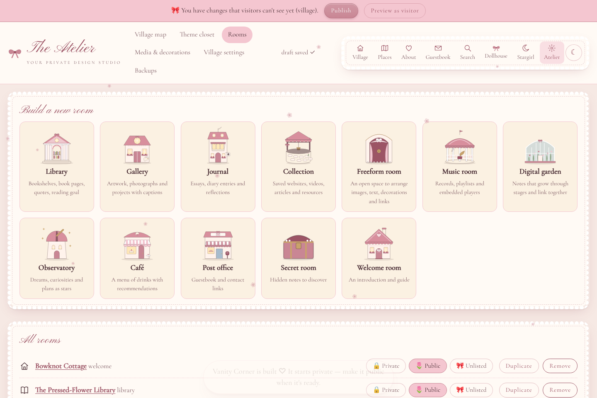

## 7. Add books and journal pages

Open a room while signed in. A dashed pink bar (*♡ only you see this*) holds the editing buttons.

**Library:** press **+ Add a book**. Fill in what you like: title, author, shelf, a cover image or a cloth colour, hearts, pages read, review, favourite quotes (one per line), and even a *secret message* visitors find by clicking a pressed flower. *Private notes* never leave your account, even on public books. Drag books along a shelf, or onto another shelf, to rearrange them. **Shelves & goal** renames shelves and sets your yearly reading goal.

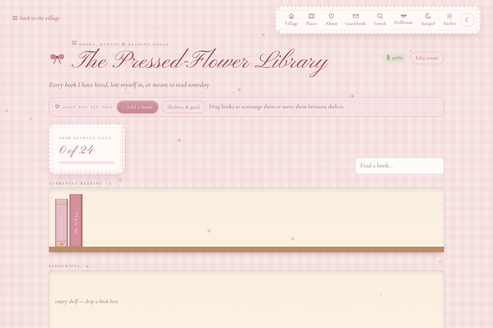

**Journal (Inkwell House):** press **+ Write a new page**. New pages are **private** until you choose *Public* or *Unlisted* (only people with the link). Tick *Archived* to tuck a page into the archive drawer. You can write **bold** with `**double stars**`, *italic* with `*single stars*`, quotes with `>` and links like `[my favourite essay](https://…)`.

**Digital garden:** **+ Plant a seed** for a note. Choose its stage (Seedling 🌱, Growing 🌿, Blooming 🌸; rename these in Village settings). Link notes together by writing another note's title in double square brackets, like `[[On keeping a commonplace book]]`. Linked notes show "notes that grow towards this one" at the bottom.

**Dollhouse → Diary** gathers all your pages and notes in one place, with a **+ Today's page** button.

## 8. Follow creators with RSS

Go to **Dollhouse → Favorites**.

1. Press **+ Follow someone**.
2. Paste the address of a blog, Substack, podcast or website. Ribbonmere looks for its feed for you. YouTube works with channel links that contain `/channel/UC…`, and with playlist links.
3. Choose a category (Books & Literature, Writing & Creativity…, or type your own).

New posts appear newest first. That's the whole algorithm. You can filter by creator, category, *unread* or *saved*. Mark things read, ♡ save them, or send them to **Read later**. Press **↻ Refresh** to check for new posts; "last updated" tells you when that last happened. If a site can't be reached, it gets a ⚠ and the reader carries on with the others.

Some places don't offer feeds: Instagram, Pinterest, TikTok, and YouTube's *Watch Later* list. For those, save links in the Cabinet (step 9) instead.

Moving from another reader? **Import OPML** brings all your subscriptions at once, and **Export OPML** takes them elsewhere.

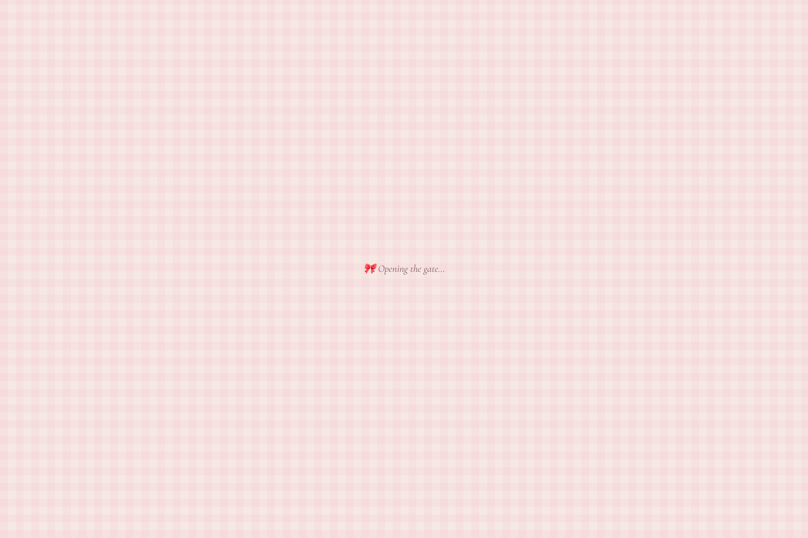

## 9. Save links and organise collections

**The Letterbox** (**Dollhouse → Inbox**) is for anything you want to deal with *later*. Paste a link or type an idea and press **Save ✉**.

- With the **cooldown** on (24 hours by default), new letters *rest* before they appear as unopened. You can always **Peek anyway**. Change the hours or turn it off with *change*.
- For each letter, choose **Keep**, **Later** (it joins your Reading Room queue), **To a collection** (files it in the Cabinet), **Archive**, or **✕** delete.
- **Tags & reminder** adds tags, a note, and a reminder date. Due reminders show at the top of the letterbox and on your dashboard.

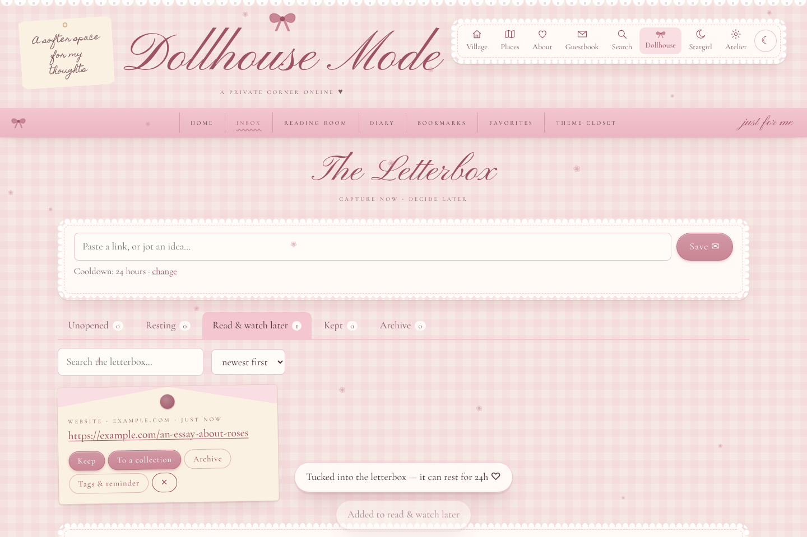

**The Cabinet of Curiosities** (**Dollhouse → Bookmarks**) holds your saved places. Press **+ Save a link**, paste the address, and the title and preview are fetched for you when the site allows it. Choose a collection (Favourite Websites, Watch Later, Pinterest Boards, Articles, Research… or type a new one). Add tags and a label, and ♥ your favourites. YouTube links appear as little TVs, articles as magazines, pins as polaroids. **Import bookmarks (.html)** brings in bookmarks exported from Chrome, Safari or Firefox.

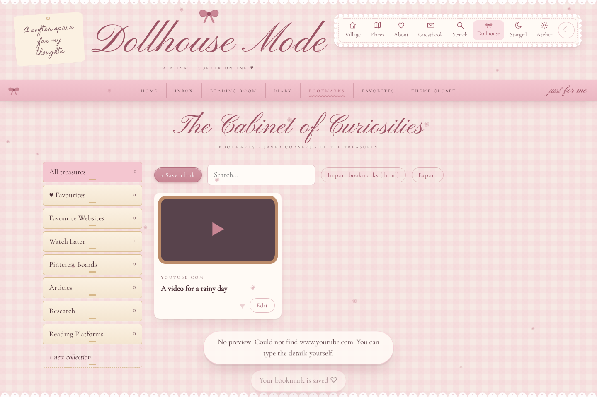

**Your dashboard** (**Dollhouse → Home**): press **Arrange widgets** to drag them around, change their size (⤢), hide them (◉), rename them, remove them, or add new ones from the widget library.

**Stargirl → Rabbit Holes** is for exploring on purpose. Start an expedition with a name, an optional goal and an optional timer, pocket discoveries as you go, then **End expedition**. Everything you found is kept in **Saved Discoveries**. From there you can move finds to the letterbox or cabinet.

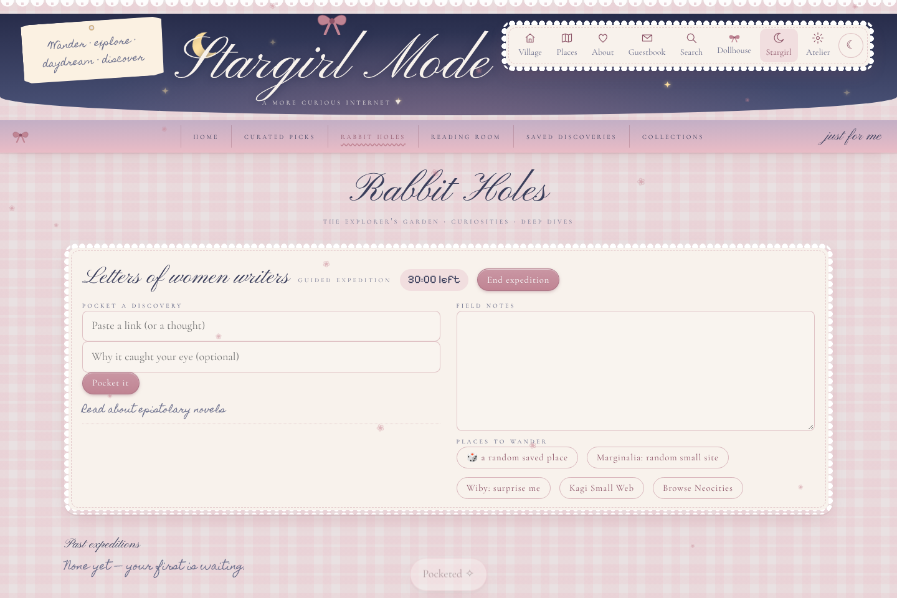

## 10. Back up your world

Go to **Atelier → Backups**.

- **Download backup** saves one file with your whole world: the village, rooms, theme, every book, page, note, bookmark and letter, your feeds and saved posts.
- **…including all images** adds your uploads into the same file. It's bigger, but complete.
- **Restore from a backup** puts a backup back, replacing what's there. **Merge** adds a backup's contents to what you already have.
- **Checkpoints:** every time you publish (and before every restore) a checkpoint is saved automatically. Press **Load** to bring an older version back as your draft, then publish it if you like it.

Do a backup now and then and keep it somewhere safe, like your cloud drive. The file is plain JSON, so your world is never locked inside this website.

## 11. Publish changes

There are two kinds of change:

- **Content** (books, pages, notes, artworks, records, drinks…) is saved the moment you press **Save**. Its *Private / Public / Unlisted* setting decides who sees it.
- **Design** (the map, rooms, theme, village settings) is saved as a **draft**. A pink banner reminds you when you have unpublished changes. Press **Publish** in the banner, the editor or the Theme Closet to make them live.

Before publishing, use **Preview as visitor** (or ☾ → *See it as a visitor*) to see exactly what a visitor would see. **Discard draft** throws away unpublished design changes and goes back to what's live.

## 12. Use it from your phone

The site works in any phone browser. It can also live on your home screen like an app:

- **iPhone / iPad (Safari):** tap the Share button → **Add to Home Screen**.
- **Android (Chrome):** tap ⋮ → **Install app** (or *Add to Home screen*).

Once it's installed on **Android**, Ribbonmere appears in the system **Share** menu. Share a link from any app, and it drops straight into your letterbox (you need to be signed in). On **iPhone**, apps added to the home screen can't join the Share menu. Paste links into the letterbox instead, or use the bookmarklet in Safari (it's under *save from anywhere* at the bottom of the letterbox).

On a phone, the map can be zoomed with **＋ / －** and scrolled with your finger. The **Places** link gives a plain list of every room.

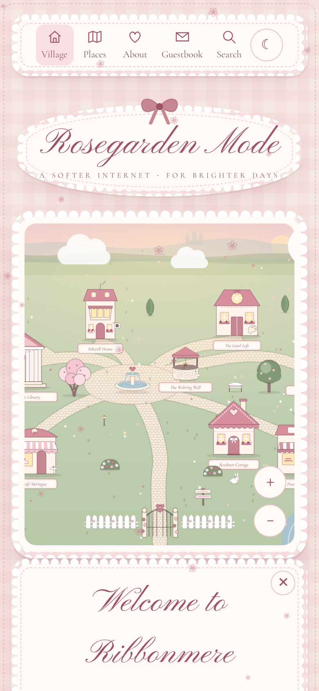

## 13. Private vs. public

- **Private:** only you, when signed in. This is the default for journal pages, notes, bookmarks, letterbox items, expeditions, to-dos and new rooms.
- **Public:** anyone visiting your village. This is the default for books, artworks, records, drinks and stars, and you can change it on each one.
- **Unlisted:** not shown in lists or search, but anyone with the exact link can open it. Good for sharing one journal page with one friend.

This is enforced by the **server**, not by hiding things in the page. Private things are never sent to a visitor's browser at all. That holds even inside a public item: a public book's *private notes* are removed before it's sent. A whole private room hides everything inside it.

Uploaded images are the one exception. To show on public pages, image files are served to anyone who has their (long, random, unguessable) address. Don't upload something you'd never want shared.

---

*Comfort settings:* anyone can turn animations and little chimes on or off from the ☾ menu, and Ribbonmere always follows your device's "reduce motion" setting.
